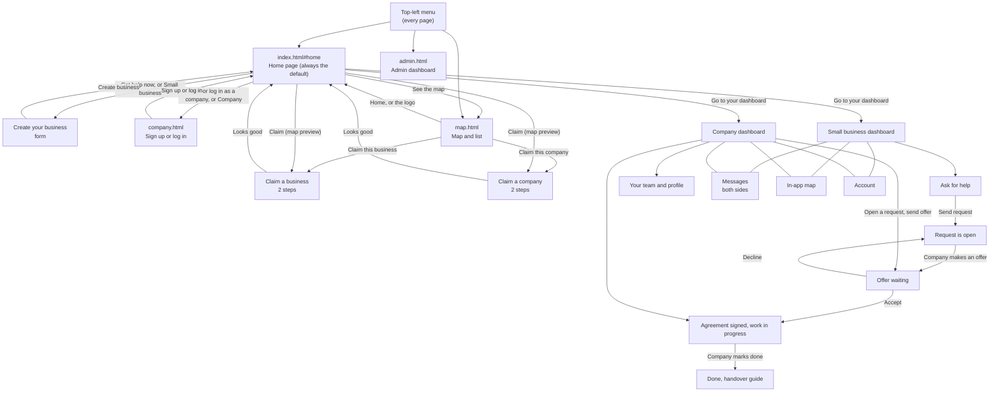

# NEhelp

Small businesses and the larger companies who can help them, in one place. "NEhelp" sounds like "any help", and it means North East help.

- **Small businesses** create their business (or claim it from the map), say what would help in plain words, and get offers and messages from larger companies nearby.
- **Companies** sign up (or claim their company from the map), add their team, see the requests that fit, message the owners and make offers under a short agreement.
- **A map and a list** show every small business and company, and which of them are already on NEhelp.
- **An admin dashboard** shows the NEhelp team what it looks like from the owners' side.

**Status:** hackathon demo. Signed-up profiles, requests, offers, messages and ratings are made up. The businesses on the map that haven't signed up are real, with names changed.

## Run it

It's plain HTML, CSS and JavaScript. There is nothing to install, build or run on a server.

- Open `index.html` in a browser, or
- put the folder on any static host (GitHub Pages, Netlify, Cloudflare Pages and so on).

Fonts and the map library (Leaflet) load from the internet, and the map needs internet for its tiles. Everything else works offline from the browser's saved data.

## Privacy: three layers

The idea behind NEhelp is that each person only sees what they should.

| Layer | Example | Who sees it |
|---|---|---|
| Public facts | Name, area, has a website? | Everyone |
| Needs the owner shares | "Wants help with taxes" | Companies, only if the owner chooses to share it |
| Private guesses | "No accountant and the tax deadline is 31 January" | The owner only |

In this static demo each screen simply shows the right layer for its role. For example, companies see "Café in Newcastle" instead of a business name until the owner accepts an offer, while the admin dashboard shows real names. Nothing enforces this behind the scenes, so treat it as a working picture of the rule, not a security guarantee. A real version would enforce it on a server.

## Where Claude fits

In the full design, Claude would turn a few plain words into a clear request when a small business asks for help (**Ask for help**), and the owner would check it before sending. That needs a backend that holds a Claude API key, and this static version doesn't include one. Here the draft is made on the page itself from the owner's words.

## Not built yet

- Real sign-in and payments. Sign-up, log-in and membership are demos, and nothing is checked or charged.
- A backend. Everything is saved in the browser only, so it isn't shared between people or devices, and the admin dashboard only sees this browser's data.
- Claude drafting (see above).
- Real checks against official sources. The map uses a saved snapshot of OpenStreetMap data and Food Standards Agency hygiene ratings.
- Real message delivery. Messages are saved in the browser and nothing is sent.
- Pins for businesses and companies you create yourself. Only ones claimed from the list have a place on the map.
- Ratings that other small businesses can browse.

---

## Pages and files

Everything lives together in one folder, so every link between pages is a plain relative link (`map.html`, `company.html`, `admin.html`, `index.html#home`). There are no sub-folders.

### The four pages

| Page | What it does | Who it's for |
|---|---|---|
| `index.html` | The main app, and the page everything starts from. One page that swaps between screens: the home page, creating or claiming a business or company, both dashboards, messages, the in-app map and the account page. Which screen shows is set by the part after the `#` in the address (see "Screens inside index.html"). **The home page is always the default**, whoever is signed in. | Everyone |
| `company.html` | Company **Sign up** and **Log in**. Sign-up is the form that creates a company: name, your name, work email, the services the team can help with, where in the North East, and the kinds of help (free, discounted or paid). Blank text fields use sample details, so both tabs work with nothing typed. Afterwards it goes back to the home page in `index.html`. | Larger companies |
| `map.html` | The public map of small businesses and companies, as a map or a list, with a filter for **All**, **Small businesses** or **Companies**. Public facts only. Every business or company that isn't signed up yet has a **Claim** button. No server needed. | Everyone |
| `admin.html` | The admin dashboard for the NEhelp team: key numbers, requests by stage, demand by service and area, sign-ups by week, the most active companies, membership income, what needs attention and recent activity. It reads the same saved data as the app, so it changes as you create, claim and sign up. There is no login in this demo. | The NEhelp team |

All four pages share the same header: the top-left menu, the logo, the **Small business** and **Company** switch, and the **Map** button. The logo always goes to `index.html#home`. The top bar and buttons turn **teal** on the small business side and **orange** on the company side, and `map.html` follows whoever is signed in.

### The top-left menu

The menu button at the top left opens a dropdown on every page. It has **Home**, **Map**, **Small business**, **Company**, **Company sign up or log in**, the signed-in side's own pages (shown on small screens, where the side menu is hidden), and **Admin dashboard** under "NEhelp team".

### The other files

| File | What it holds |
|---|---|
| `nehelp.css` | Shared brand styles used by all four pages (colours, fonts, header, buttons, cards, dashboards, message threads, map pins). |
| `state.js` | The test data, saving to the browser, the six service colours, claiming helpers, and the top-left menu. |
| `businesses.js` | The public data for the maps: 122 small businesses and 13 companies. |
| `landing.js` | The home page, the **Create your business** form, and the claim-a-business screens. |
| `layout.js` | The page frame (side menu, summary panel) plus quick links, info cards and the account page. |
| `business.js` | Small business screens: overview, ask for help, your requests, offers. |
| `company.js` | Company screens: requests, your team, profile, account, and the claim-a-company screens. |
| `messages.js` | Messages between companies and small business owners, for both sides, including the pop-up for writing a message. |
| `map.js` | The map and list, shared by the in-app map, the preview maps and `map.html`. |
| `dialogs.js` | Pop-ups: request details and agreements, handover guide, display settings, edit business, delete account. |
| `app.js` | Works out which screen to show, handles every button, and starts the app. |

`index.html` loads the scripts in this order, and they all share one global scope: `state`, `landing`, `layout`, `business`, `businesses`, `map`, `messages`, `company`, `dialogs`, `app`. `company.html` loads `state.js`. `map.html` loads `state.js`, `businesses.js` and `map.js`. `admin.html` loads `state.js` and `businesses.js`. That way every page shares the same saved data.

### Services

Every request and employee belongs to one of six services, each with its own colour on pills, chips and cards: **Finance**, **Marketing**, **Employment**, **Website & tech**, **Legal** and **Design**.

### The test data

So the app looks like it does when it's in use, it comes with:

- **122 small businesses** on the map: 100 real ones (names changed), 18 already on NEhelp, and 4 test ones that aren't signed up yet.
- **13 companies** on the map: 6 already on NEhelp and 7 that can be claimed.
- **26 requests** at every stage (open, offer waiting, in progress, done), a mix of free, discounted and paid.
- **9 messages** between owners and companies, and a team of 10 people for the demo company.

The demo small business is The Corner Café and the demo company is Tyne Digital, until you create or claim your own.

### Screens inside `index.html`

| Address | Screen |
|---|---|
| `index.html#home` | **Home page.** The default: shown when there is no address, an unknown address, or one you can't use, signed in or not. When you're signed in a banner offers **Go to your dashboard**. |
| `index.html#go-business` | Opens the small business dashboard if you already have a business. If you don't, it opens the form to create one (never a claim page). Used by the **Small business** links on other pages. |
| `index.html#go-company` | Opens the company dashboard if you have a company. If not, it goes to the sign-up form on `company.html`. Used by the **Company** links on other pages. |
| `#new-business` | **Create your business**: the form new small businesses fill in |
| `#claim-<id>` | **Claim a business or company**: opened from a **Claim** button on the map or a list, for that one business or company. Confirm it's yours, then check the details. |
| `#b-issues` | Small business overview: status for each service, requests, next steps, activity, companies ready to help, map preview |
| `#b-new` | **Ask for help**: describe the problem and send a request |
| `#b-messages` | **Messages**: everything companies have sent, with a reply box |
| `#b-companies` | **Offers**: offers waiting, companies working with you, finished jobs and handover guides |
| `#b-update` | **Your requests**: rename requests and change their status |
| `#b-map` | Map or list of nearby businesses and companies |
| `#b-account` | Account: profile, notifications, business details, download or delete your data |
| `#c-requests` | **Requests**: company overview with requests that fit the team, demand, capacity, activity, partner guide, map preview |
| `#c-messages` | **Contact businesses**: message the owner of any request that fits |
| `#c-companies` | **Businesses you work with** |
| `#c-add` | **Your team**: add people, change what each person helps with, and mark them away |
| `#c-map` | Same map as the small business side |
| `#c-profile` | Company profile: areas, hours, kinds of work, membership |
| `#c-account` | Account: same as the small business account, for the company contact |

## App flow

### A small business, step by step

1. Land on the home page (`index.html#home`). It's where everyone starts.
2. Get a business in one of two ways:
   - **Create it.** Press **Get help now** (or **Small business** in the header) to open the **Create your business** form: name, kind of business, where it is, address, opening hours, your name and email. Blank fields use sample details in this demo.
   - **Claim it.** Open the map (**See the map**, or **Map** in the header), find your business in the list or on the map, and press **Claim this business**. Confirm it's yours, then check the details. Businesses already on NEhelp don't have the button, and neither does anyone who already runs a business.
3. You're taken back to the home page, which now says you're signed in. Press **Go to your dashboard**.
4. The **dashboard** shows each service at a glance.
5. **Ask for help**: type or pick an idea, and a draft request is made from your words. Check it, choose free, discounted or paid, and send it.
6. Companies make offers and send messages. Under **Offers** you can accept or decline, and **Messages** has a reply box. Accepting signs a short agreement.
7. When the company finishes, open the **handover guide**.
8. Along the way: **Map** shows nearby businesses and companies, and **Account** holds your profile, notifications and your data.

### A company, step by step

1. From the home page, press **Join or log in as a company** (or **Company** in the header) to reach `company.html`. Get a company in one of two ways:
   - **Create it.** **Sign up** with the company name, your name, work email, the services your team can help with, where in the North East, and the kinds of help you'll give. (Or **Log in** with an email.)
   - **Claim it.** Find your company on the map or the list (use the **Companies** filter) and press **Claim this company**. You get its services, places, kinds of help and team.
2. You're taken back to the home page, where **Go to your dashboard** is waiting.
3. The **dashboard** shows requests that fit, with a tag saying why any don't (outside your area, no one free, and so on).
4. Open a request, pick an employee, set hours and a price, and **send an offer**, or **Contact the owner** first. The business name stays hidden until they accept.
5. Once accepted, the job shows as in progress. **Mark done** when finished.
6. **Your team** is where you add people and change what each one helps with. **Company profile** changes areas, hours and kinds of work. **Your impact** adds up agreed work and free hours.

### Swapping between the two sides

The **Small business** and **Company** switch in the header takes you to that side's dashboard. If that side isn't set up yet it opens the form to create one instead. One browser can hold both, so you can swap back and forth to see each side's point of view.

### The map page, step by step

1. Open `map.html` from **Map** in the header or **See the map** on the home page.
2. Switch between **Map** and **List**, and filter by **All**, **Small businesses** or **Companies**. Round pins are small businesses (teal when on NEhelp, amber when not). Square pins are companies (navy when on NEhelp, grey-blue when not). It opens on Newcastle and Gateshead, so zoom out for Tynemouth, Sunderland and Durham.
3. Click a pin or a row for details. Run one of the ones that isn't signed up? Press **Claim this business** or **Claim this company**. This is the only way to claim.
4. Use the top-left menu, the **Small business** and **Company** links, or the logo to go back to the app.

### The admin dashboard, step by step

1. Open the top-left menu on any page and choose **Admin dashboard** (or open `admin.html`).
2. The cards at the top show small businesses and companies on NEhelp, open requests, agreements signed, free hours given, agreed work, membership income a month and messages sent.
3. Below are requests by stage, demand by service, where requests come from, new sign-ups by week, the most active companies, membership, what needs attention (requests with no offers after a week, unread messages, no one free) and recent activity.
4. Go back to the app, create a business or claim a company, then reopen the admin dashboard. The numbers move.

### Where the data lives

- **In the browser** (`localStorage`, key `nehelp-v5`): the dashboards, requests, offers, messages, employees and accounts. **Reset demo data** in the avatar menu clears it, and **Delete my account** does the same.
- **In `businesses.js`**: the public data on the maps. It's a file in the folder, so no server is involved.
- Nothing needs a server. The dashboards and the map use separate data for now, so a request sent from a dashboard doesn't show up as a pin.

## Credits

- Food hygiene ratings: Food Standards Agency, Open Government Licence v3.0.
- Business data on the map: © OpenStreetMap contributors (ODbL).
- Maps: [Leaflet](https://leafletjs.com/).
